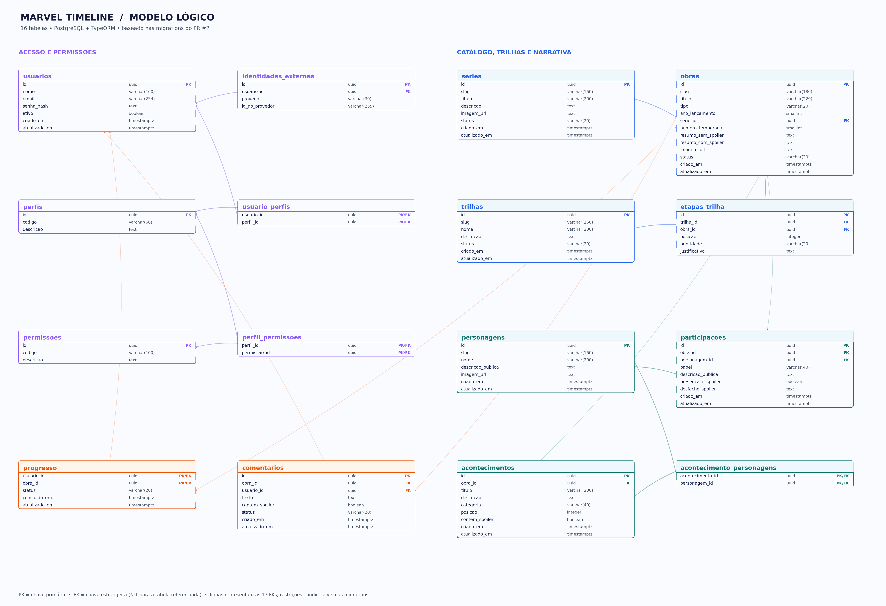

# Guia do banco para implementar a API

**Estado:** modelo e dados iniciais integrados à main; as rotas, os guards e o Swagger ainda serão escritos. Este guia descreve o esquema existente, não funcionalidades já entregues.



Imagem em [PNG](modelo-logico.png) e [SVG ampliável](modelo-logico.svg), gerada a partir das duas migrations por [`scripts/gerar_modelo_logico.py`](../scripts/gerar_modelo_logico.py). O diagrama mostra campos, tipos, PK e FK; índices, unicidade e verificações mais detalhadas permanecem nas migrations. Atualize a imagem quando o esquema mudar.

## Uma obra não é um endpoint

Um **registro** é uma linha em uma tabela: `obras` contém 34 registros iniciais. Um **endpoint** é uma combinação de método HTTP e rota no Nest, por exemplo `GET /obras`. Esse endpoint consulta várias linhas; o parâmetro `:slug` de `GET /obras/:slug` escolhe uma delas. `GET /obras/vingadores-guerra-infinita` e `GET /obras/wandavision-temporada-1` são chamadas do **mesmo** endpoint.

| Chamada futura | Serviço consulta/grava | Resultado esperado |
| --- | --- | --- |
| `GET /obras?tipo=FILME&anoLancamento=2018&pagina=1&limite=10` | `obras`, filtrando `tipo` e `ano_lancamento` | Lista paginada, `itens` e `meta` com total; não cria nada |
| `GET /obras/vingadores-guerra-infinita` | Uma linha de `obras`, por `slug` | Resumo público; spoiler só quando solicitado explicitamente |
| `GET /trilhas/curta/etapas` | `trilhas` → `etapas_trilha` → `obras` | Ordem de exibição, com paginação e filtros de etapa |
| `GET /explorar/trilhas/curta/obras/vingadores-guerra-infinita` | Mesmas relações + `participacoes`/`acontecimentos` | Experiência de visitar a obra na trilha, sem spoiler por padrão |
| `POST /obras` | Valida DTO, autorização ADMIN, grava em `obras` | Nova obra; **ainda precisa ser implementado** |

Exemplo de resposta futura para `GET /obras?pagina=1&limite=10&tipo=FILME&anoLancamento=2018`:

```json
{
  "itens": [{ "slug": "vingadores-guerra-infinita", "titulo": "Vingadores: Guerra Infinita", "tipo": "FILME", "anoLancamento": 2018 }],
  "meta": { "pagina": 1, "limite": 10, "total": 1, "totalPaginas": 1 }
}
```

O JSON ilustra o contrato **proposto**: nenhum controller o entrega ainda. Uma lista sempre precisará de paginação e de pelo menos **dois filtros por campos persistidos**, documentados no Swagger. Filtros não criam endpoints adicionais.

## As 16 tabelas

| Tabela (entidade TypeORM) | Colunas principais | Relação e uso |
| --- | --- | --- |
| `series` (`Serie`) | `id`, `slug`, `titulo`, `descricao`, `imagem_url`, `status` | Uma série agrupa temporadas; série não é uma etapa de trilha. |
| `obras` (`Obra`) | `id`, `slug`, `titulo`, `tipo`, `ano_lancamento`, `serie_id`, `numero_temporada`, `resumo_sem_spoiler`, `resumo_com_spoiler`, `imagem_url`, `status` | Filme ou temporada. `serie_id`/`numero_temporada` só em temporada; sem episódios. |
| `trilhas` (`Trilha`) | `id`, `slug`, `nome`, `descricao`, `status` | Duas trilhas iniciais: `curta` e `longa`. |
| `etapas_trilha` (`EtapaTrilha`) | `id`, `trilha_id`, `obra_id`, `posicao`, `prioridade`, `justificativa` | Liga uma obra à trilha. Cada par trilha/obra e cada posição na trilha são únicos. Uma obra pode estar nas duas trilhas sem duplicar seus dados. |
| `personagens` (`Personagem`) | `id`, `slug`, `nome`, `descricao_publica`, `imagem_url` | Cadastro único de personagem; não há versões alternativas nesta modelagem. |
| `participacoes` (`Participacao`) | `id`, `obra_id`, `personagem_id`, `papel`, `descricao_publica`, `presenca_e_spoiler`, `desfecho_spoiler` | Vínculo único entre personagem e obra; marca presença e desfecho sensíveis a spoilers. |
| `acontecimentos` (`Acontecimento`) | `id`, `obra_id`, `titulo`, `descricao`, `categoria`, `posicao`, `contem_spoiler` | Eventos ordenados dentro da obra. |
| `acontecimento_personagens` (`AcontecimentoPersonagem`) | `acontecimento_id`, `personagem_id` | Quais personagens participam de um acontecimento. |
| `usuarios` (`Usuario`) | `id`, `nome`, `email`, `senha_hash`, `ativo` | Conta local; `senha_hash` pode ser nulo para conta Google. Nunca retornar o hash. |
| `identidades_externas` (`IdentidadeExterna`) | `id`, `usuario_id`, `provedor`, `id_no_provedor` | Reserva o vínculo estável do login Google à conta; a integração OAuth ainda falta. |
| `perfis` (`Perfil`) | `id`, `codigo`, `descricao` | Perfis iniciais `LEITOR` e `ADMIN`. |
| `permissoes` (`Permissao`) | `id`, `codigo`, `descricao` | 26 ações iniciais; códigos no seed. |
| `usuario_perfis` (`UsuarioPerfil`) | `usuario_id`, `perfil_id` | Perfis atribuídos a cada usuário. |
| `perfil_permissoes` (`PerfilPermissao`) | `perfil_id`, `permissao_id` | Ações permitidas para cada perfil. |
| `progresso` (`Progresso`) | `usuario_id`, `obra_id`, `status`, `concluido_em`, `atualizado_em` | Um estado por usuário e obra: `QUERO_VER`, `ASSISTINDO` ou `CONCLUIDO`. |
| `comentarios` (`Comentario`) | `id`, `obra_id`, `usuario_id`, `texto`, `contem_spoiler`, `status` | Conversa compartilhada pelas duas trilhas porque é ligada à obra; `PUBLICADO`, `OCULTO`, `REMOVIDO`. |

As colunas exatas, tipos e restrições estão em [`backend/src/database/entities/`](../backend/src/database/entities/) e nas [migrations](../backend/src/database/migrations/). Os timestamps `criado_em`/`atualizado_em` aparecem nas tabelas pertinentes. Use novas migrations para qualquer alteração estrutural; `synchronize` está desligado.

## Como os dados chegam lá

1. `db:migrate` cria tabelas, chaves estrangeiras, índices e verificações de integridade no PostgreSQL.
2. `db:seed` insere, de forma repetível, dois perfis, 26 permissões, 3 séries, 34 obras (4 temporadas), duas trilhas com 55 etapas, e uma amostra de personagens e acontecimentos para **quatro** obras. As outras obras têm título/resumo para o fluxo inicial, mas ainda não têm a mesma riqueza narrativa.
3. Opcionalmente, em ambiente de desenvolvimento, `SEED_DEMO_USERS=true` com duas senhas de demonstração cria ADMIN/LEITOR, comentários e progresso de exemplo. Sem essa opção, o banco não contém contas de teste. A opção é bloqueada em produção.
4. Os controllers Nest ainda precisarão usar essas entidades; o seed não torna uma rota acessível automaticamente. Cada módulo liga controller → serviço (regras) → repositório TypeORM → banco.

## Segurança: o que o esquema permite e o que ainda falta

- **Já modelado:** hash opcional para cadastro local/Google, unicidade de e-mail, vínculo com identidade externa, perfis, permissões e relacionamentos; o seed dá a `ADMIN` as ações de gestão e a `LEITOR` ações próprias de conta, progresso e comentários.
- **Ainda não implementado:** cadastro/login, verificação de senha, emissão/validação JWT, OAuth Google, guards de perfil/permissão, autorização por proprietário, DTOs, exclusão de spoilers, moderação em serviços e testes de acesso. A existência das tabelas **não protege** nenhum endpoint por si só.
- O seed é dado de desenvolvimento, não mecanismo para criar administradores em produção. Segundo fator exigiria decisões de fluxo e persistência adicionais; não está preparado pelas 16 tabelas.
- Não exponha `DATABASE_URL` nem senhas no GitHub, no Swagger, em mensagens do grupo ou no frontend. A API é a responsável por acessar o banco.

O esquema acomoda o conjunto de operações proposto na [matriz de endpoints](matriz-endpoints.md), inclusive mais de 60 rotas úteis, **sem uma tabela por endpoint**. A validade acadêmica depende de implementar, documentar e testar cada operação.
